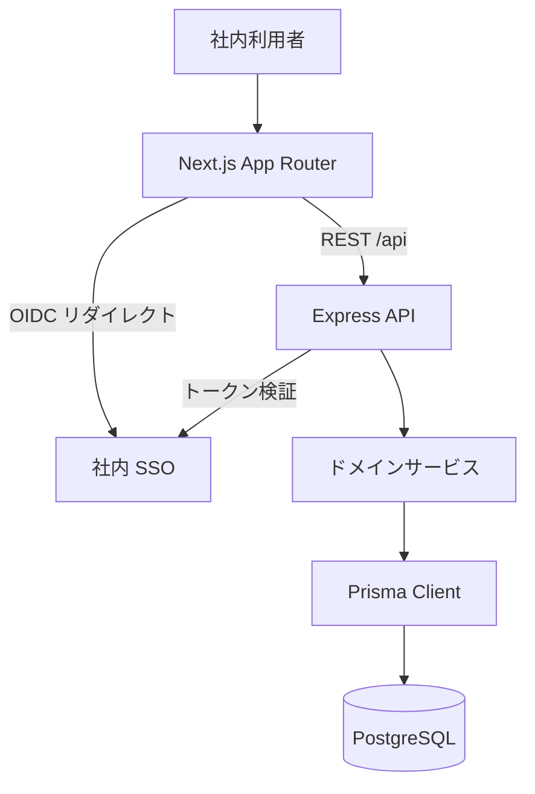

# ARCHITECTURE

## システム概要

<!-- 記入ガイド
このファイルは記入例である。内容は自分のプロジェクトの実態に置き換える。
見出しの名前と順序は固定されている。追加・改名・並べ替えを行わない。欠けているセクションがあってもよい。
この節には、プロジェクトの目的・利用者・主要な技術的制約を散文 1 段落で書く。
全体アーキテクチャ図は任意とする。図がないと全体像を誤解するときだけ Mermaid で置く。
載せるのは全体像の把握に要る要素だけとし、個々のクラス・関数・テーブルは載せない。図の構文は検証されない。
-->

社内チーム向けのタスク管理 Web アプリケーション「Tsukuyomi」。利用者は自社の従業員に限られ、
外部には公開しない。認証は社内 SSO(OIDC)に委ね、パスワードを自前で保持しない。
単一リポジトリで frontend / backend / data をディレクトリで分離しており、monorepo ツールは使わない。



## 技術スタック

<!-- 記入ガイド
表は言語・ランタイム・フレームワーク・データ層の役割だけを持つ。役割を担う技術名とマイナーまでのバージョンを同じセルに書く。
パッケージマネージャ・UI ライブラリ・補助ライブラリ・Lint・テストのツールは表に載せない。マニフェストを読めば分かる。
バージョン方針・更新の条件・併用を禁じるツールは、表の下の箇条書きに書く。表にカラムを足さない。
設定ファイルを開けば分かる個々の設定値(`strict` の有無など)は書かない。
-->

| 区分 | 採用技術 |
| --- | --- |
| 言語 | TypeScript 5.6 |
| フロントエンド | Next.js (App Router) 14.2 |
| バックエンド | Express 4.21 |
| ORM / データ層 | Prisma 5.22 |

- Next.js のメジャー更新は手動でのみ行う。
- Prisma のスキーマ変更は `prisma migrate` で行い、SQL を直接当てない。
- 依存の追加は pnpm で行う。npm / yarn を併用しない。

## ディレクトリ構成

<!-- 記入ガイド
主要ディレクトリをツリーで示し、各行に責務を 1 行で書く。
置き場を迷うディレクトリに絞り、全ディレクトリを網羅しない。
レイヤーがディレクトリに対応するときは、行の責務の前に `[レイヤー名]` を付ける。レイヤーが 1 つしか無いプロジェクトは付けない。
レイヤーがディレクトリに対応しないとき(ファイル名の接尾辞で層を分けるなど)は、ツリーの下にレイヤーの表を置き、上から下へ各レイヤーの責務を 1 行で書く。
許される依存方向をツリーの下に箇条書きで書く。書かれていない方向を読み手に推測させない。禁止する方向は `## 禁止事項` に書く。
ツリーのパスを `## ドメインマップ` の glob と矛盾させない。
-->

```
src/
  app/           # [UI 層] 画面(ページ・レイアウト)
  components/    # [UI 層] 再利用する UI コンポーネント
  api/           # [API 層] HTTP の受け口。入力の検証と、ドメインの返り値の DTO への詰め替え
  server/        # [ドメイン層] 業務ルールの実装。HTTP と永続化の詳細を持たない
  lib/           # 層をまたいで共有するユーティリティ
prisma/
  schema.prisma  # [データアクセス層] スキーマ定義
  migrations/    # [データアクセス層] マイグレーション履歴
db/
  seed.ts        # [データアクセス層] 開発用シードデータ
tests/
  e2e/           # ブラウザ経由の E2E テスト
```

依存は UI 層、API 層、ドメイン層、データアクセス層の順に下へ流れる。

- 上の層は 1 つ下の層だけを参照する。
- `src/lib` はどの層からも参照してよい。

## ドメインマップ

<!-- 記入ガイド
ドメイン名から、そのドメインに属するパスの glob への写像を書く。
開始行の info string は `json metatron:domains` に固定する。ブロック内は有効な JSON だけを置く(コメント不可)。
分割が馴染まないプロジェクトは `{ "generic": ["**"] }` に縮退させる。
このブロックを機械的に読むのは、metatron の CLI と hook、codiel の `initializing-harness`、
`orchestrating-runs`、`check-intent-env` である。codiel の `guard-write` hook は読まない。
書き込みの禁止をこのブロックに期待せず、触ってほしくないパスは `## 禁止事項` に書く。
-->

```json metatron:domains
{
  "frontend": ["src/app/**", "src/components/**"],
  "backend": ["src/server/**", "src/api/**"],
  "data": ["prisma/**", "db/**"]
}
```

`src/lib` はどのドメインにも属さない。

## コマンド定義

<!-- 記入ガイド
`package.json` の `scripts` などの定義から読めない使い方だけを載せる。候補が複数あるときの使い分け、実行の前提、引数の付け方が当たる。
`pnpm test` のように定義の名前に実行コマンドを付けただけで前提も無い行は載せない。
定義されていても使わないコマンドと、使えなくなったコマンドは載せない。
実行できる形そのままで書く。省略形・別名を書かない。
前提(依存のインストール、環境変数)が要るコマンドは、その前提を同じ行に書く。
-->

| 用途 | コマンド | 前提 |
| --- | --- | --- |
| e2e | `pnpm exec playwright test` | `pnpm exec playwright install chromium` を 1 度実行しておく |
| build | `pnpm build` | `.env` に `DATABASE_URL` があること |
| 1 ドメインのテスト | `pnpm test -- src/server/billing` | なし。全件の `pnpm test` より先に回す |

## テスト方針

<!-- 記入ガイド
ユニットテストと E2E の役割分担、テストファイルの配置規約と命名規約を書く。
新規テストをどこへ追加するかが、読んだだけで決まる粒度にする。
-->

- ユニットテストは Vitest で書き、テスト対象と同じディレクトリに `<対象>.test.ts` として置く。`src/server/task-service.ts` のテストは `src/server/task-service.test.ts` とする。
- 分岐を持つ関数には、異常系のケースを 1 件以上書く。
- E2E は Playwright で書き、`tests/e2e/<画面名>.spec.ts` に置く。対象ブラウザは Chromium だけとする。
- カバレッジの数値目標は設けない。

## 禁止事項

<!-- 記入ガイド
禁止を 1 項目に 1 つ書き、代わりに取る手段を同じ項目に併記する。「〜しない」で終えない。
触らないパスには、変更が必要になったときに取る手順(誰に確認するか)を併記する。
禁止する依存方向・触らないパス・読まないパスを含め、禁止は他の見出しに書かない。
-->

- UI 層は Prisma Client を直接呼ばない。データが要るときは API 層にエンドポイントを追加し、そこを経由する。
- ドメイン層は Express の `Request` / `Response` を参照しない。リクエスト固有の値が要るときは、API 層が引数として渡す。
- データアクセス層は UI 層の型を参照しない。画面都合の形が要るときは、API 層で DTO に詰め替える。
- 同じ層の中で循環参照を作らない。共有したい処理があるときは `src/lib` へ切り出す。
- `prisma/migrations/**` の適用済みのマイグレーションは書き換えない。変更が要るときは新しいマイグレーションを追加する。
- `.github/workflows/**` の CI 定義は変更しない。変更が要るときは人間に確認する。

## 変更時の追随

<!-- 記入ガイド
パスまたは glob ごとに、変更したときに確かめること(通すテスト・確かめる条件)と、同時に直すものを書く。
そのパスが何であるかは `## ディレクトリ構成` に載っていれば書かない。載っていないパスは、何であるかを語句 1 つで添えてよい。
禁止とその代わりの手段は `## 禁止事項` に書き、ここで繰り返さない。
-->

- `src/server/auth/**`(認証・認可の実装)を変更したら、`pnpm test src/server/auth` を通し、権限の境界のケースが増えていることを確認する。
- `src/lib/**` を変更したら、全ドメインから参照されるので `pnpm test` を全件実行する。
- `prisma/schema.prisma` を変更したら、`prisma migrate dev` で作ったマイグレーションを同じコミットに含める。
